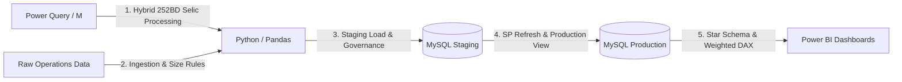

```markdown
🌐 **Language / Idioma:** [English](README_EN.md) | [Português](README.md)

---

# 📊 Guaranteed Fund Interest Rate Engineering & Quantitative Analytics

[](./python/)
[](./sql/)
[](./power_query/)
[](./dax/)

---

## 📋 Table of Contents
- [🏙️ Business Context](#️-business-context)
- [⚠️ Business Pain Points](#️-business-pain-points)
- [🛠️ Technical Solution & Problem Resolution](#️-technical-solution--problem-resolution)
- [📂 Repository Structure & Code](#-repository-structure--code)
- [💎 Value Generation for Management](#-value-generation-for-management)
- [🎯 Conclusion & Decision Making](#-conclusion--decision-making)

---

## 🏙️ Business Context

In the credit guarantee fund ecosystem, the institution acts as a guarantor to mitigate default risk for micro and small enterprises (individual microentrepreneurs, micro, and small businesses) obtaining loans from partner banks and financial cooperatives.

To monitor fund effectiveness and ensure partner institutions comply with operational guidelines, executive leadership requires clear visibility into the **average interest rate charged to end-borrowers**.

However, the massive volume of loans originated by dozens of partner financial institutions creates a decentralized data stream where each bank reports interest rates using its own standards, periodicities, and field structures.

[⬆ Back to Table of Contents](#-table-of-contents)

---

## ⚠️ Business Pain Points

1. **Heterogeneity & Lack of Standardization:** Unstandardized partner bank files (mixed monthly vs. annual rates, decimals vs. percentages, period vs. comma separators).
2. **Ambiguity Between Fixed and Floating Rates:** Difficulty in identifying whether reported rates were fixed or tied to the market benchmark (Selic), preventing direct comparison of effective rates.
3. **Cumulative Benchmark Distortion (12M Time Gap):** For recent operations lacking 12 full months of historical data, compounding only elapsed days artificially depresses annual floating rate calculations.
4. **Absence of Volume-Weighted Metrics:** Simple average analysis masked actual financial exposure, giving low-value transactions the same visual weight as large financial loans.

[⬆ Back to Table of Contents](#-table-of-contents)

---

## 🛠️ Technical Solution & Problem Resolution

To resolve these pain points, an end-to-end analytical pipeline was engineered where Power Query initially processes the benchmark table, feeding into the Python calculation engine and relational storage:



Technical Layers Breakdown:
Time Series & Benchmark (Power Query / M Language): Initial processing on the FATO_SELIC table, combining actual historical daily rates with market projections adjusted to the 252 business days financial standard.

Data Cleaning & Business Rules Engine (Python): The script consumes the processed Selic base and operations data, enforcing type casting, scale correction, and size-based operational thresholds (MEI, ME, and EPP) to compute the Real Annual Rate and Weighted Value.

Relational & Governance Layer (SQL): Isolates staging (painel_tx) from production schemas (produtofinal) and automates view recreation using Stored Procedures.

Weighted Metrics Layer (Power BI / DAX): Star Schema model creation and DAX measure engineering for dynamic Volume-Weighted Average Interest Rate calculations.

⬆ Back to Table of Contents

📂 Repository Structure & Code
Access code files and scripts for each pipeline stage inside their respective folders:

📄 Versão em Português: README.md

🐍 Python Data Pipeline: python/processamento_taxas.py

🗄️ SQL Stored Procedure & Views: sql/sp_gerar_view_txjuros.sql

⚡ M Language (Hybrid 252BD Selic): power_query/selic_acumulada_12m.m

📊 DAX Weighted Measures: dax/medidas_taxa_ponderada.sql

├── python/
│   └── processamento_taxas.py     # Ingestion, cleaning, and rules engine script
├── sql/
│   └── sp_gerar_view_txjuros.sql  # MySQL Stored Procedures and Production Views
├── power_query/
│   └── selic_acumulada_12m.m     # M script for hybrid 12M rolling Selic (252 BD)
├── dax/
│   └── medidas_taxa_ponderada.sql # DAX measures for weighted rates and volume
├── README.md                      # Executive documentation in Portuguese
└── README_EN.md                   # Executive documentation in English

⬆ Back to Table of Contents

💎 Value Generation for Management
Standardization & Reliability: Eliminates human error from manual partner bank spreadsheet processing, delivering 100% data traceability.

True Credit Cost Visibility: Annualization and 252-business-day hybrid Selic modeling provide leadership with accurate visibility into real effective rates without operational noise.

Accurate Financial Metrics (Weighted View): Replacing simple averages with Weighted Averages ensures risk analyses accurately reflect financial volume exposure.

Operational Efficiency: Reduces report processing cycles through an automated end-to-end data pipeline (Power Query 
→ Python 
→ SQL 
→ Power BI).

⬆ Back to Table of Contents

🎯 Conclusion & Decision Making
This pipeline transformed raw, unstandardized data into strategic business intelligence. With this infrastructure, management gains technical backing to:

1. Partner Bank Negotiations: Identify financial institutions charging interest rates or spreads above regulatory ceilings and support operational renegotiations.

2. Guarantee Policy Optimization: Direct fund resources toward credit lines, company sizes, and geographic regions with fair rates.

3 .Trend Tracking: Monitor the direct impact of central bank benchmark rate fluctuations on the guaranteed portfolio using the hybrid predictive model.

🌐 Mudar para versão em Português | ⬆ Back to Top
